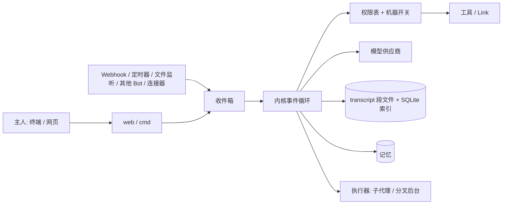

# XBot：新人导览

> **30 秒版**：XBot 是用 Go 从零写的个人 AI 助手，给一个主人在自己的机器上长期使用。交互单位是 **Bot**：一个有名字、有记忆、长期存在的实体，同一个主题只找一个 Bot，上下文一直连着，系统里没有"会话"。Bot 能在没人叫它时醒来，判断有没有值得告诉主人的事；能在授权的机器上做主人在终端里能做的事。终端和网页是同一条对话的两个入口。

## 愿景与思想
> 已确认（2026-10-16，主人确认；「现阶段优先级」一段 2026-10-18 主人确认，其余最后一段 2026-10-17 更新，主人确认）。

Bot 是第三代交互模型。第一代是 Chat，第二代是 Session 和 Agent，第三代是 Bot：一个有记忆、长期存在的实体。主人不需要管理会话，也不需要 `--resume`；想聊哪件事，就去找负责这件事的那个 Bot。

Bot 有主动性。webhook、文件监听、其他 Bot、定时器都能唤醒它；它自己判断有没有值得说的事，有就说，没有就保持安静（回复 `SILENT`）。主动性靠评测保证：看行为和结果，不看模型自己的汇报——自己设定目标，被打断后继续同一件事，做不到时停下来说明原因。

内核要薄，机制最小够用。不为特殊情况加规则，新能力尽量用已有的抽象（Link、Event、收件箱、执行器任务）表达。例如插话分叉的后台直接登记成执行器任务，确认规则收拢在一张权限表里。

Bot 是全能的。授权给它的机器，它能做主人在终端里能做的任何事。隔离靠部署方式，安全靠操作审核和保险箱，不靠假装能限制文件访问。

**现阶段优先级**：产品还没有用户，现阶段最重要的是把功能调通、调顺，然后再接安全。安全只留接口（一张权限表和它的守门测试、内核的统一审查入口、保险箱占位），不再加新的安全工作；挡住 Agent 干活的确认和拒写要收进一个默认放行的开关。见 [ADR 0013](../adr/0013-features-before-security.md)。

主人希望 Bot 任何时候都能在几秒内回应，哪怕它正忙着长任务，这一点靠「插话时分叉」做到了。现在在做的是对照 Claude Code 内部机制调研定下的 8 步内核计划：提醒通道与熔断、文件新鲜度、待办清单、shell 后台化、环境感知、搜索与看图已经合入，接下来是子代理类型；权限规则按 ADR 0013 暂缓。同时三个 Bot 连续运行两周做验收，到 10-30 结束。再往后是开源网关、P2P 和跨用户通信。新想法先进候选清单（在主人的 Obsidian，不在仓库），不当场开工；计划和进度见 [MILESTONES](../MILESTONES.md)。

## 思想地图
上面「愿景与思想」讲的是想把 XBot 做成什么样；下面几篇讲主人做这件事的方法。改内核、改提示、改合并流程之前，先读对应的那一篇。

| 思想 | 一句话 | 读完能明白什么 | 文档 |
|---|---|---|---|
| 旅程驱动 | 进度单位是主人真的会做的一件事；一次只推一条，测试全绿只算「已合入」，端到端跑通才算数，做好后进 `docs/guard/` 守着 | 下一步该做什么，什么不能弄坏，什么时候才算「做完了」 | [ideas/journey-driven.md](ideas/journey-driven.md) |
| 内核要薄 | 只留 Link、Event、收件箱、执行器任务几个抽象，约束由 harness 强制执行 | 为什么新功能先找已有抽象，为什么规则放在工具和内核里而不是提示里 | [ideas/thin-kernel.md](ideas/thin-kernel.md) |
| 评测把关，不对着题调 | 行为由评测判定；留出套件只在验收时跑；每条规则都要是通用原则 | 怎么改提示才算改好了，为什么普通套件全过还不够 | [ideas/eval-gated.md](ideas/eval-gated.md) |
| 收敛与主动补齐 | 主动做目标显然需要的配套，同时有预算、有边界、做不到就停 | Bot 什么时候该多走一步，什么时候该停下 | [ideas/convergence-and-ownership.md](ideas/convergence-and-ownership.md) |
| 分级合并门槛 | 测试全绿才合并，修复必带回归测试，大改再加复测和独立评审 | 一个改动要过哪些关才能进 main | [ideas/tiered-merge-gates.md](ideas/tiered-merge-gates.md) |
| 自我修改要可控 | Bot 改自己时，每一步都过评测门、可回滚、留记录 | 自进化可以走多远、哪些线不能碰 | [ideas/self-modification.md](ideas/self-modification.md) |

## 已有旅程
主人用 XBot 做成的事，任何改动都不能让它们退化。这些旅程横跨好几块组成（一条旅程往往同时用到内核、记忆、界面），所以不拆进组成节点，集中放在一处：

- 已经做好的在 `docs/guard/`，写明步骤和「怎样算对」，每条配一条冒烟用例：[长程运行](../guard/长程运行.md)，以及 2026-10-18 主人选定、2026-10-20 毕业的 6 条基础旅程（网页对话、忙时插话、动手做事、记住事情、主动唤醒、Bot 之间协作），合在 [六条基本旅程](../guard/六条基本旅程.md) 一个文件里。改界面要守的规矩在 [界面](../guard/界面.md)。
- 还没跑到「端到端通过」的，写在正在做的那份 dev 设计里。
- 已经做了、还没写成旅程的：启动与登录（目前包在「网页对话」里）、危险操作的确认卡、跨设备网关、桌面端、MCP 与连接应用、浏览器和桌面操作、头像与外观。同样不能弄坏，只是还没有冒烟用例；要补时按上面的格式写成旅程，带一条冒烟用例。

正在做的东西在 `docs/dev/`：有正在做的设计时才放 `docs/dev/`，里面有什么就是在做什么，做完就删，内容转进 atlas 和 `docs/guard/`。还没排上的想法在候选清单（不在仓库，在主人的 Obsidian：`正在干什么/06-XBot/XBot 候选清单.md`，按 P1–P4 往下做）。

## 你需要知道的术语
| 术语 | 白话解释 | 代码里叫 |
|---|---|---|
| Bot | 一个长期存在、有记忆的助手实体 | `bot.Bot` |
| Link | Bot 和外界之间的任何通道：出站是工具，入站是事件 | `link` |
| Event | 统一的事件结构 `{source, type, content, sender, time}` | `inbox` |
| transcript | 每个 Bot 一份只追加、带 seq 编号的原文记录 | `bot/transcript.go` |
| 主人（owner） | 拥有并授权 Bot 的人；只有主人经认证入口发的消息算可信 | `person` |
| 执行器任务 | 子代理和分叉后台共用的任务记录（`agents/<id>/`） | `exec` |

## 组成
| 部分 | 一句话 | 什么时候读 | 文档 |
|---|---|---|---|
| 内核 | Link、Event、收件箱、事件循环，以及一轮里的提醒、熔断、文件新鲜度和待办清单 | 改一轮对话怎么跑、事件怎么进来、什么时候停 | [kernel.md](kernel.md) |
| 上下文与 transcript | 固定前缀、分段存储、索引、压缩、找回、导出 | 改 `internal/bot/transcript.go`、压缩、导出 | [context.md](context.md) |
| 身份与记忆 | 人、两层记忆、冲突规则 | 改 `internal/memory`、`internal/person` | [memory.md](memory.md) |
| 子代理 | 后台子代理与执行者 | 改 `internal/exec`、`internal/agent` | [subagents.md](subagents.md) |
| 插话时分叉 | 插话时一轮分成前台和后台 | 做 F1–F5，改分支、前后台调度 | [fork.md](fork.md) |
| 多 Bot | 主 Bot、分组、Fork Bot、Bot 间通信、档案、例程 | 改 `internal/bot`、`internal/peer`、`internal/cron` | [multibot.md](multibot.md) |
| 机器与设备 | 机器开关、隧道、多台电脑靠[网关配对](gateway.md)、浏览器、桌面 | 改 `internal/machine`、`browser`、`desktop` | [machines.md](machines.md) |
| 生态 | 内置 Link、MCP、技能、连接器、编码代理 | 加 Link、改 MCP、技能或编码代理 | [ecosystem.md](ecosystem.md) |
| 安全 | 保险箱、出站代理、权限表 | 加工具（必须在权限表归类）、改确认规则 | [security.md](security.md) |
| 模型供应商与评测 | 供应商、模型提示、认证、主动性评测 | 改 `internal/provider`、`internal/eval`、`evals/` | [providers.md](providers.md) |
| 网页界面 | 侧栏、对话、信息面板（任务、轨迹、上下文）、桌面窗口 | 改 `internal/web`、静态界面和桌面外壳 | [ui.md](ui.md)；改界面先读 [guard/界面.md](../guard/界面.md) |
| 版本与自动升级 | 版本注入、tag 触发发布、检查与后台下载、装好重启、优雅重起 | 改 `internal/version`、`internal/upgrade`、`internal/web/update.go` | [release.md](release.md) |
| 网关 | 开源信箱中继，连接主人自己的几台 XBot（G1–G6 已实现）。官方网关 `gateway.babelgo.cn:8443` 是腾讯云上的 Go 服务器（Cloudflare Workers 上的 `xbot.babelgo.cn` 留作备用），也能用 Go 自建 | 做 M8、改 `gateway-worker/` | [gateway.md](gateway.md) |

## 怎么配合

所有输入都变成 Event 进收件箱，每个 Bot 一个事件循环按顺序处理。一轮里内核组装上下文、调模型、把工具调用交给权限表审查后执行，所有结果只追加进 transcript。

**走查：主人在网页上发一句「帮我看看这个 bug」。**
1. 网页 `POST /api/bots/{name}/messages` 接住（[internal/web/server.go](../../internal/web/server.go)），认证后成为可信事件。
2. 内核拿到处理锁，组装上下文：固定前缀（人设、规则、Link 说明）+ 摘要块 + 未压缩的尾巴 + 有变化时的环境更新（[context.md](context.md)）。
3. 调用绑定的模型（[internal/provider](../../internal/provider/)）；回复里的多个工具调用并行执行。
4. 每个工具调用先过权限表和机器开关（[security.md](security.md)）；读文件、shell 读命令直接跑，删除或对外发送弹确认卡，卡片也写进 transcript。
5. 结果按调用顺序追加进 transcript，SSE 流式回网页；轨迹进信息面板（[ui.md](ui.md)）。
6. 如果这一轮很长、主人又插了一句，这一轮分叉成后台继续，前台几秒内回答（[fork.md](fork.md)）。

## 文档地图
| 文档 | 在哪 | 给谁 | 活的 / 冻结 | 谁维护 |
|---|---|---|---|---|
| 项目说明与构建 | [README.md](../../README.md) | 所有人 | 活的 | 主人 |
| 已做好的旅程 | [docs/guard/](../guard/)（[长程运行](../guard/长程运行.md)、[六条基本旅程](../guard/六条基本旅程.md)、[界面](../guard/界面.md)） | 主人、编码 Agent | 活的，步骤和「怎样算对」只有主人能改；冒烟用例和级别随测试同步 | Agent 同步，毕业要主人确认 |
| Agent 入口 | [AGENTS.md](../../AGENTS.md) | 编码 Agent | 活的 | 主人 |
| 里程碑与进度 | [MILESTONES.md](../MILESTONES.md) | 主人、开发者 | 活的，天天变 | Bot 复刻 |
| 网页 HTTP 接口 | [API.md](../API.md) | 界面开发者 | 活的 | 开发者 |
| 候选清单 | 主人的 Obsidian：`正在干什么/06-XBot/XBot 候选清单.md`（不在仓库） | 主人、XBot 主管 | 活的，新想法先进这里，不当场开工；记了不用提交 | 主人、XBot 主管（周调研、每晚复盘的新想法也记这里） |
| 调研笔记 | [docs/research/](../research/) | 开发者 | 写完即冻结，结论进候选清单或里程碑 | Bot 复刻 |
| 教训 | [LESSONS.md](../../LESSONS.md) | 编码 Agent、Bot 复刻 | 活的，同一条出现 3 天升级成硬约束 | Bot 复刻 |
| 正在做的设计 | [多 Provider](../dev/multi-provider.md)、`docs/dev/`（有正在做的设计时才放） | 主人、编码 Agent | 活的，只放正在做的那一件；做完就删，现状提炼进 atlas，旅程移进 `docs/guard/` | XBot 主管写，Agent 同步进度和级别；旅程的步骤和「怎样算对」主人定 |
| 规格（旧） | [MEMORY-V2.md](../MEMORY-V2.md)（记忆 v2）、[GATEWAY.md](../GATEWAY.md)（网关与跨设备）、[SCORECARD.md](../SCORECARD.md)（评测成绩单） | 主人、开发者 | 定下来就冻结，落地后提炼进 atlas 和 ADR；新设计不再走这条路，改用 `docs/dev/` | Bot 复刻 |
| 自建网关 | [gateway-selfhost.md](../gateway-selfhost.md) | 想自己跑网关的用户 | 活的 | 开发者 |
| 决策记录 | [docs/adr/](../adr/) | 开发者、将来的主人 | 守护层，只追加 | 主人 |
| 旧设计入口 | [DESIGN.md](../DESIGN.md) | — | 已并入 atlas，只留指针 | — |
| 官方网关部署 | [gateway-worker/README.md](../../gateway-worker/README.md) | 运维网关的人 | 活的 | 开发者 |
| 模型提示 | [prompts/models/README.md](../../prompts/models/README.md) | 调提示的人 | 活的 | 开发者 |
| 模型提示正文 | [deepseek-flash.md](../../prompts/models/deepseek/deepseek-flash.md)、[deepseek-chat.md](../../prompts/models/deepseek/deepseek-chat.md) | 模型 | 活的 | 开发者 |

## 全局要求：性能与界面流畅
- 链路不传大块数据：只传摘要或流式传输；每次节点调用上限 1 MiB，处处设大小上限。
- 交互回复 p95 < 3 秒；本机进程间通信（IPC）额外开销 p95 < 5 毫秒；后台导致的变慢不超过 10%。
- 界面：60fps；动画只动 transform/opacity，普通过渡不超过 200 毫秒，弹性动画最长 300 毫秒（弹出用 `--dur-pop` 220 毫秒，气泡回弹 300 毫秒）；遵守 prefers-reduced-motion；轮询不能引起重排、卡顿或抢焦点。
- 每个里程碑验收都要报性能数字。

ADR 一览：[0001 多个后台](../adr/0001-multiple-backgrounds.md)、[0002 前台写操作自动排队](../adr/0002-foreground-writes-auto-queue.md)、[0003 一张权限表](../adr/0003-one-permission-table.md)、[0004 去掉主动性三档](../adr/0004-drop-proactivity-levels.md)、[0005 保险箱交给独立系统用户的守护进程](../adr/0005-vault-daemon-user.md)、[0006 记忆只留两层](../adr/0006-two-memory-scopes.md)、[0007 本地优先的桌面端](../adr/0007-local-first-desktop-app.md)、[0008 记忆 v2：默认写日志，常驻快照加差异](../adr/0008-memory-v2-dated-log-first.md)、[0009 每个记忆范围是一个文件夹，用普通文件工具编辑](../adr/0009-memory-as-folder.md)、[0010 跨设备靠开源信箱中继传 Bot 消息，不同步数据](../adr/0010-gateway-mailbox-relay.md)、[0011 官方网关跑在 Cloudflare Workers 上，客户端默认连它](../adr/0011-official-gateway-on-workers.md)、[0012 退役「节点」，多台电脑只靠网关配对](../adr/0012-retire-node.md)、[0013 现阶段先把功能调通调顺，安全只留接口](../adr/0013-features-before-security.md)、[0014 后台不做续段，也不再按步数限制](../adr/0014-no-background-segments.md)、[0015 上下文分两条线：软目标和硬上限，都从模型推出来](../adr/0015-soft-target-hard-ceiling.md)、[0016 前台只理解和派活，干活交给预制类型的子代理（已被 0028 取代）](../adr/0016-foreground-dispatches-typed-subagents.md)、[0017 主人的话直接插进正在跑的一轮，不进收件箱](../adr/0017-owner-words-go-straight-into-the-turn.md)、[0018 确认卡不挡主人说话：插话时挂起，决定稍后送达](../adr/0018-cards-never-block-the-owner.md)、[0019 默认不弹权限卡，主人自己控制](../adr/0019-no-permission-cards-by-default.md)、[0021 环境流：一切会变的状态只追加差异，不改前缀](../adr/0021-env-stream.md)、[0028 无前后台之分：主 Agent 全工具，长活直接 subAgent](../adr/0028-no-foreground-background-split.md)。
